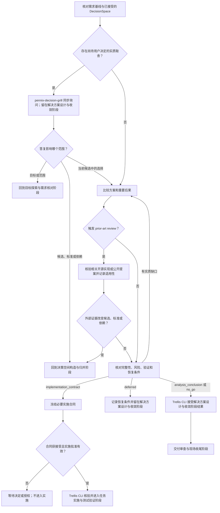

# 解决方案设计与收敛阶段流程

核对有效的目标基线、决策空间构造与归并阶段结果或跳过记录及其 revision。按依赖筛选影响目标、范围、成功条件、用户偏好、风险承受或重要取舍的保留决定；使用 `pennix-decision-grill` 同步提问。答复到达后，核对其权限、当前 revision 和影响范围：影响目标或范围时回到目标探索与需求核对阶段，影响候选、标准或依赖时回到决策空间构造与归并阶段，仅改变当前候选中的方案时继续本阶段评估。待决定事项使解决方案设计与收敛阶段保持待决。

比较适用方案，说明选择依据、重要后果、行为边界、责任、必要依赖、验证方式、停止与恢复条件及实质风险。对新颖核心机制、重大重构、跨组件边界变化或关键不确定性缺少可信本地先例的方案，在结果接受前完成有界 `prior-art review`，记录适用性、采纳或排除理由，或说明没有适用先例。外部材料改变候选、标准或依赖时回到决策空间构造与归并阶段。

判断当前结果：分析交付形成 `analysis_conclusion`；不继续形成 `no_go`；延期形成带责任方、触发条件和恢复位置的 `deferred`，留在解决方案设计与收敛阶段；实施路线形成 `implementation_contract`，明确目标、范围和接受条件，并按路线需要补足实施与核验信息。只有交付物具有独立实施或集成边界时才拆分工作包，并说明推进和协作所需的依赖、顺序、责任或集成信息；单一交付不人为拆分工作包。解决方案设计与收敛阶段的结果接受与实施授权分开记录；只有合同及明确批准均有效时，Trellis CLI 才允许进入任务实施与测试验证阶段。

### 方案是否足以收敛

实施者应能从当前方案判断要做什么、由谁负责、依赖什么、如何验证，以及何时停止或恢复；影响选择、接受、安全、权限、成本或不可逆影响的取舍应有依据和处理方式。未知事项可以补证、接受剩余风险、延期或不继续。此判断不要求固定篇幅、备选数量、字段或图表。
