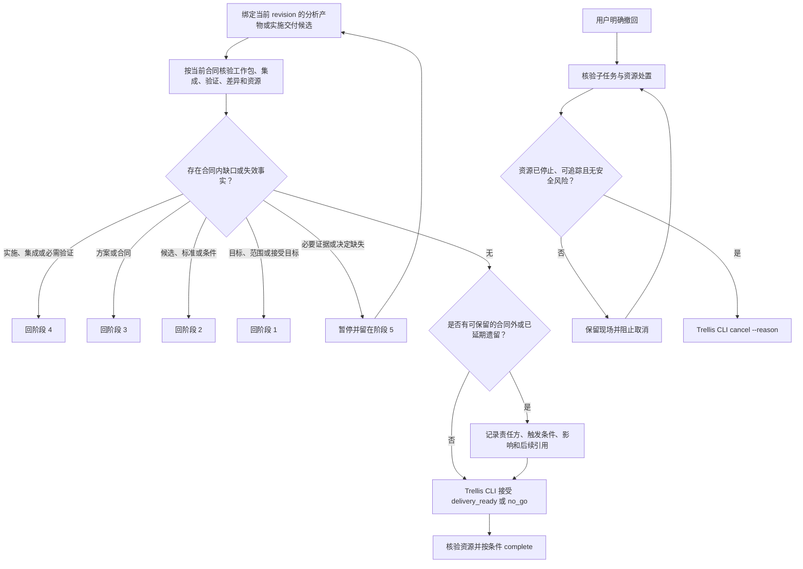

# 交付审查与收尾阶段流程

绑定当前 `task_route_revision`、输入和结果 revision，按阶段 3 冻结的优先级和依赖检查阶段 4 的工作包、集成、验证、合同差异、未结发现、必需子任务及资源事实。分析型路线只核对实际分析产物，不制造实施工作包。验证按通过、失败、未运行或受限记录；合同允许且风险可接受时说明未运行原因、影响和替代证据，否则暂停或回阶段 4。

实施、集成或必需验证缺陷回阶段 4；方案、合同、风险、依赖、回退或停止条件失效回阶段 3；候选、标准或条件变化回阶段 2；目标、范围或接受目标变化回阶段 1。必要证据或用户决定缺失时留在阶段 5 等待。当前合同内未完成工作不能改记为遗留后关闭。合同外、已明确延期或撤回后不继续的事项，可在现有收尾产物中记录范围、责任方、触发条件、影响和后续任务引用；没有遗留时不另造清单。

满足当前合同且没有待处理缺口时，由 Trellis CLI 接受交付审查并形成 `delivery_ready`；`no_go` 也须经阶段 5 审查后才能完成任务。只有合同、用户明确要求或不可由主代理替代的重要价值与风险取舍需要用户接受时，才等待用户确认。用户要求修改或拒绝时，使当前交付候选失效并按影响回流。调用 `complete` 前核验任务生命周期与资源安全。若用户明确撤回，则先在阶段 5 核验子任务和资源；仍可能写入、泄露或造成数据风险时保留现场并阻止取消，风险解除后才调用 `cancel --reason`。

### 与会话交接的边界

正式会话交接包仅在用户明确要求时按其独立 Skill 处理。它不改变阶段、路线或任务状态，也不是 `delivery_ready`、`complete` 或 `cancel` 的前置条件。
